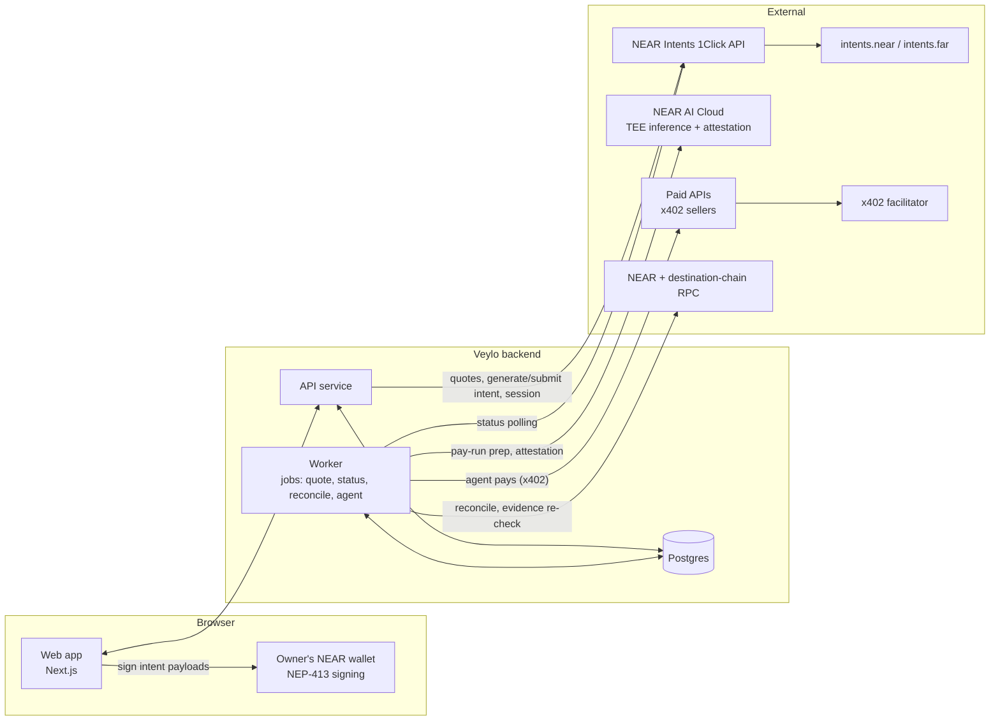
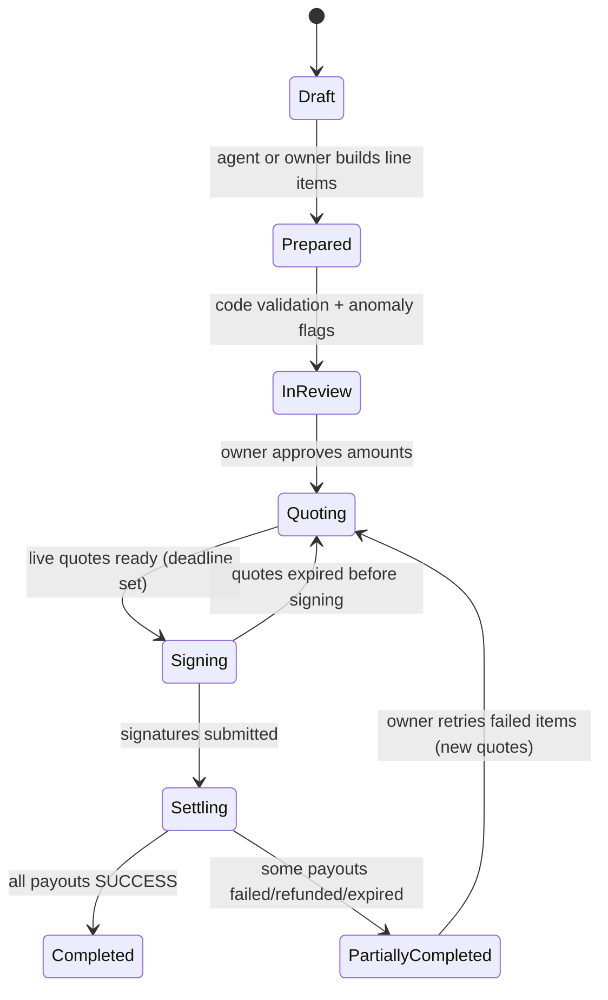

# ARCHITECTURE.md — Veylo (Phase 3 DRAFT, for founder review)

Status: **v1.0, APPROVED by founder 2026-11-06.** Changes require a new DECISIONS.md entry.
Every capability is labeled: **[proven]** (verified live in Phase 2), **[planned]** (designed, relies only on proven pieces), **[needs spike]** (depends on something not yet verified; see §12).

Thesis (locked, narrowed by L46): Private borderless payroll on NEAR: one confidential treasury pays your global team: gasless for everyone, and payroll that isn't publicly linked to your company.

**Rule:** wherever the headline appears (README, landing page, pitch), the evidence-backed condition appears with it: what was checked, the fresh-address condition, and who can still see details (see `docs/PRIVACY.md`).

---

## 1. Principles

1. **The backend never holds the treasury key.** Only the owner's wallet signs payouts (D3, L6).
2. **The AI proposes, code verifies, the owner signs.** The LLM extracts and explains; deterministic code computes every amount; nothing moves without the owner's signature.
3. **Our ledger is the source of truth** for payroll history (1Click history is invite-only; rule 6).
4. **Every on-chain action is recorded with its hashes** and re-checkable by `npm run verify` (L7).
5. **Live and simulated are separate, labeled modes.** Simulated records never appear in totals, evidence or exports as real.
6. **No claim beyond evidence.** UI copy, README and docs use the D1 privacy stage table, not absolutes.
7. **Modular monolith, not microservices.** One API service plus one worker process, sharing domain packages.

---

## 2. System overview



**Key flows:**
- **Fund treasury** [proven]: any-chain asset → 1Click quote → treasury's Intents balance (T5 funding via BSC USDT).
- **Shield** [proven]: public Intents balance → confidential balance, owner-signed (T5b).
- **Pay run** [proven mechanics]: per-contractor quote → owner signs each intent → settle in parallel (T5, T5b, T5c).
- **Contractor cash-out** [proven]: contractor's confidential balance → their chain, signed by the contractor (T5d).
- **AI pay-run prep** [needs spike: completions blocked on credits; attestation responses proven].
- **Agent API payments** [proven on testnet only] via x402 (T7).

---

## 3. Tech stack (proposed; founder decisions marked ⚑)

| Layer | Choice | Reason |
|---|---|---|
| Language | TypeScript, strict | One language across web, API, worker |
| TS version | ⚑ **TypeScript 5.x pinned** (not 7.x) | Verification showed TS 7 conflicts with NEAR ecosystem packages |
| Runtime | Node 24 LTS + pnpm 11 (pinned via `.nvmrc` / `engines` / `packageManager`) | Node 20 is end-of-life (L19) |
| Monorepo | pnpm workspaces | Shared domain packages, one lockfile |
| Web | Next.js (App Router), React | Owner and contractor portals; wallet signing client-side |
| API | Fastify | Typed, fast, simple; long-running friendly |
| Jobs | pg-boss (Postgres-backed queue) | No Redis to operate; transactional with our data |
| Database | Postgres | Relational ledger, constraints for idempotency |
| ORM / migrations | Drizzle | SQL-first, lightweight, typed |
| Validation | Zod | Every API input and every external response |
| Wallet connection | **NEAR Connect** (per NEAR docs; Wallet Selector README points to "HOT Connect", to be confirmed as the same project) | `signMessage` mapping proven offline (S-A). **Supported wallets = tested wallets only:** Meteor first; MyNearWallet unsupported for payouts (forced `callbackUrl` alters the signed hash) |
| NEAR signing (server-side, agents only) | near-api-js (pinned) | Proven in verification for NEP-413 and key handling |
| Intents | Thin in-house client over 1Click REST | Built from proven pieces; avoids the intents SDK's dependency/audit load (L5). ⚑ Revisit if SDK becomes necessary |
| x402 | `@fastnear/x402` (pinned) | Proven on testnet (T7) |
| AI | OpenAI-compatible client → NEAR AI Cloud | Proven API shape; TEE models |
| Hosting | ⚑ Web on Vercel; API + worker on Railway or VPS | Workers need long-running processes |
| CI | GitHub Actions running `pnpm verify` | L7 |

---

## 4. Repository structure (proposed)

```
veylo/
├── apps/
│   ├── web/                 # Next.js: owner portal, contractor portal, public read-only demo
│   └── api/                 # Fastify API + worker entrypoint (src/server.ts, src/worker.ts)
├── packages/
│   ├── core/                # Pure domain logic: pay runs, payout state machine, fees, policies. No I/O.
│   ├── db/                  # Drizzle schema, migrations, repositories
│   ├── intents/             # 1Click client, NEP-413 payload helpers, status/reconcile utilities
│   ├── agent-pay/           # Agent wallets, spending policy, x402 payer wrapper
│   ├── ai/                  # NEAR AI client, extraction prompts, attestation fetch + verification
│   ├── chains/              # Address validation per chain, public RPC readers
│   └── config/              # Env schema (Zod), shared constants (read-at-runtime values, never salts)
├── tools/
│   └── verify/              # `pnpm verify`: tests, dry quotes, attestation verify, evidence re-check, privacy check
├── docs/
│   ├── PRIVACY.md           # D1 stage table, conditions, trust disclosures
│   ├── SECURITY.md          # Threat model (§9)
│   └── EVIDENCE.md          # Every real mainnet payout/payment with hashes and links
├── verification/            # Phase 2 workspace, isolated; never imported (L5)
├── README.md  AGENTS.md  CLAUDE.md  ARCHITECTURE.md  DECISIONS.md  VERIFICATION.md  LICENSE
```

Rule: `packages/core` has zero network or database access, so the money logic is fully unit-testable.

---

## 5. Accounts, custody and signing

| Actor | NEAR identity | Who holds the key | Can move treasury funds? |
|---|---|---|---|
| Company owner | Their NEAR wallet account (the treasury account) | Owner's wallet (browser) | **Yes, only by signing in their wallet** |
| Finance viewer / accountant | Their NEAR wallet (sign-in only) | Their wallet | No (role-gated read access) |
| Veylo backend | None for treasury | Holds 1Click partner key, NEAR AI key, agent keys (encrypted) | **No** |
| AI agent (pay-run prep) | None | n/a | **No.** Proposes only |
| AI agent (API spend) | Its own dedicated NEAR account | Backend, encrypted at rest | Only its own budget balance (D4) |
| Contractor (private receipt) | Their own NEAR account | Their wallet | Only their own confidential balance |

**Treasury setup:** the treasury is the owner's NEAR account. Implicit accounts sign intents with no setup [proven]. Named accounts must call `add_public_key` on `intents.near` from the account itself, with exactly 1 yoctoNEAR attached and ~100 TGas, using a full-access key; this requires a little NEAR once [documented, untested; spike S-J]. The onboarding wizard handles both. Wallet signing: one prompt per payload (no documented multi-message API) [S-A].

**Key storage** [planned/partly built]: two separate master keys (L31). `SESSION_ENCRYPTION_KEY` (API) encrypts 1Click session tokens; `AGENT_KEY_MASTER_KEY` (worker only) encrypts agent keys. Both use envelope encryption (per-org data key, XChaCha20-Poly1305, associated data bound to org, purpose and record). Agent keys are decrypted only inside the worker, in memory, per payment.

**Sign-in** [planned]: "Sign in with NEAR": server issues a nonce challenge; the wallet signs it (NEP-413); server verifies and sets an httpOnly session cookie. Sessions scoped to org memberships.

---

## 6. Core flows

### 6.1 Treasury funding and shielding
1. Owner picks a source chain/asset and amount → API requests a 1Click quote with `recipientType: INTENTS`, recipient = treasury [proven].
2. Owner sends from their own wallet to the single-use deposit address; the worker polls status to terminal.
3. Shield to confidential: quote `INTENTS → CONFIDENTIAL_INTENTS`, owner signs in wallet, submit [proven].
   - [needs spike S-D] Funding straight into `CONFIDENTIAL_INTENTS` from an external chain (one step instead of two).
4. Every step writes a `treasury_events` row with quote, correlation ID and all hashes.

**Visible publicly:** the treasury and total amounts for funding and shielding (D1).

### 6.2 Contractor onboarding
1. Owner invites a contractor (email link).
2. Contractor chooses a payout mode (D1):
   - **Direct to wallet:** chain + token + address. Validated per chain (`packages/chains`), then a **dry quote** confirms 1Click accepts it (rule 1; format checks alone are insufficient).
   - **Private receipt:** contractor connects their NEAR wallet; payouts go to their confidential balance.
3. **Address hygiene** (rule 8): each destination stores `received_public_payout`. Switching a contractor from Direct to Private, or cashing out privately to an address flagged as having received a public payout from the company, triggers a warning with a fresh-address recommendation.
4. **Destination changes** are high-risk (fraud vector): they require contractor re-confirmation, are flagged in the next pay run, and are never silently applied to an in-flight run.
5. **Approved payees (T-2 defense, part B)** [signing + verification proven offline, S-A]: when the owner approves a destination, their wallet signs (NEP-413) a payee record `{org, contractor_id, chain, destination_asset, recipient, recipient_type, version, approved_at, expires_at}`. The backend stores it but cannot forge or alter it. Only owner-signed, unexpired payees that are members of the current registry head can be paid.
   - **Registry head (anti-rollback):** every payee change produces a new owner-signed head `{org, version (strictly increasing), hash of the full active payee set, signed_at}`. Revocations remove the payee from the set.
   - **Browser high-water mark:** the browser stores the highest head version seen per org and refuses any lower version.
   - **Expiry:** approvals expire (default 180 days) and require re-approval, bounding any rollback window.
   - **Planned (spike S-I):** anchor the head hash on-chain so a fresh device can verify freshness via NEAR RPC.
   - **Residual (disclosed):** first load on a brand-new device trusts the served head, within the expiry window.
6. **Address-control proof** [needs spike]: the contractor proves control of their payout address by signing with it (NEAR wallet for private receipt; chain-native message signing for direct addresses). Reduces first-entry risk.

### 6.3 Pay run (the core flow)



1. **Prepare.** Line items come from contractor terms plus uploaded invoices/timesheets (§7). Code computes amounts; the AI only extracts and explains.
2. **Review.** Owner sees each item: amount, basis, destination, payout mode, flags, and a **fee preview from dry quotes** per destination chain (D6).
3. **Quote.** On approval, the worker requests live quotes for every item (`depositType: CONFIDENTIAL_INTENTS`; `recipientType: DESTINATION_CHAIN` for Direct, `CONFIDENTIAL_INTENTS` for Private) [proven]. Quotes carry deadlines; the signing step shows a countdown.
4. **Sign.** For each item, the API calls `generate-intent` and returns the payload; the owner's wallet signs it unmodified; the browser sends signatures back. [needs spike S-A] browser wallet NEP-413 output → `signedData` mapping, and whether wallets can sign several payloads in one prompt.
5. **Submit and settle.** API submits each signed intent; the worker polls `/v0/status` per payout until terminal; parallel, independent [proven].
6. **Reconcile.** After terminal status, a delayed re-check (≥30 s) plus confidential balance reads via User-Session finalize amounts and refunds (rule 5) [proven lag].

**Security gate before signing (T-2 defense, A + B + C), run in the browser for every item; any failure blocks signing (fail closed):**
- **A. Quote authenticity** [signature check proven offline, S-C]: verify 1Click's ed25519 signature on the quote against the pinned 1Click key (versioned config; confirmation of key and rotation policy requested from 1Click).
- **B. Right recipient** [proven offline, S-A]: the quote's signed `recipient`, `destinationAsset` and `recipientType` must exactly match an **owner-signed, unexpired payee record** that is a member of the **current registry head** (version ≥ the browser's high-water mark). Signatures are verified with the owner's full-access public key fetched **directly from NEAR RPC** (`view_access_key_list`), or derived from the account ID for an implicit account, never from the Veylo backend.
- **B2. Registered signing key** [built, slice W3, L45]: before a payout signature, the browser confirms via NEAR RPC (`has_public_key`) that the wallet's signing key is registered for the treasury on **the verifier the payload names** (its NEP-413 `recipient`). Only the verifiers pinned in `packages/intents` are accepted: `intents.near` and `intents.far` (confidential payouts sign for `intents.far`). Any other verifier fails B2 without an RPC call. Implicit accounts signing with their own key need no registration.
- **C. Right amount** [built, slice W1, ceiling L45]: the payload's `receiver_id` must equal the quote's `depositAddress`; the signed amount may exceed the payout by at most **max(1 USDC, 1% of the payout)** (catches unsigned `appFees`).
- **No reliance on unsigned quote fields** (`appFees`, `confidentiality`, `insured`, `depositMode`). Privacy mode is enforced via signed `depositType` / `recipientType`.

### 6.4 Payout state machine (per line item, per attempt)

Statuses: PLANNED, QUOTED, SIGNED, SUBMITTED, PROCESSING, SUCCESS, REFUNDED, FAILED, EXPIRED. Terminal: SUCCESS, REFUNDED, FAILED, EXPIRED.

Allowed transitions: PLANNED→QUOTED | PLANNED→FAILED (quote rejected) | QUOTED→SIGNED | QUOTED→EXPIRED | QUOTED→FAILED (gate blocked / generate-intent rejected) | SIGNED→SUBMITTED | SIGNED→EXPIRED | SIGNED→FAILED (submit rejected) | SUBMITTED→PROCESSING | SUBMITTED→SUCCESS/REFUNDED/FAILED (poll may skip PROCESSING; history records only observed states) | PROCESSING→SUCCESS/REFUNDED/FAILED.

- Reconciliation is a separate field (`reconciled_at`), not a status (L18).
- FAILED requires a `failure_reason`.
- Each retry is a **new attempt** with a new quote and new deposit address (single-use). Retry from FAILED/EXPIRED after a status check; from REFUNDED only after reconciliation confirms the refund; never after an earlier attempt succeeded.
- **Never re-sign or re-submit without checking the previous attempt's status first** (rule 3).
- DB constraints: `UNIQUE(deposit_address)`, `UNIQUE(line_item_id, attempt_no)`, and at most one non-terminal attempt per line item.
- Partial failure is designed for but **unobserved** (rule 4) [needs spike S-E].

### 6.5 Contractor cash-out (private receipt)
Contractor portal shows their confidential balance (their own User-Session, signed by their wallet) and offers withdrawal to any supported chain [proven T5d]. UX guidance: partial withdrawals, fresh addresses (rules 8, 9).

---

## 7. AI pay-run agent

**Job:** turn messy inputs (invoices, timesheets, contractor terms) into a reviewed draft pay run.

| Step | Who does it | Notes |
|---|---|---|
| Extract fields from documents | LLM on NEAR AI Cloud (TEE model) | Inputs treated as **untrusted** (prompt-injection risk) |
| Compute amounts | Deterministic code in `packages/core` | LLM output never used as an amount without recomputation |
| Validate | Code: schema, totals, rate × hours, currency, limits | Mismatches become flags |
| Detect anomalies | Code rules (duplicate invoice number/hash, amount deviation vs history, new or changed destination, new contractor, over-budget) + LLM narrative explaining each flag | Rules decide; LLM explains |
| Propose | Writes a `Prepared` pay run | Cannot quote, sign or submit |

**Attestation** [partial]: each agent run fetches `GET /v1/attestation/report` with a fresh nonce and stores it. **Cryptographic verification** with NEAR AI's verifier is required before the UI or README says "verified private AI" [needs spike S-F]. Until then, UI says "attestation recorded, verification pending".

**Model** (D5): candidates `z-ai/glm-5.3-flash`, `Qwen/Qwen3.6-35B-A3B-FP8`; final choice after completions run.

**Logging:** prompts and outputs are stored encrypted; logs never contain document contents in plaintext. Optional PII scrubbing via `openai/privacy-filter` [planned].

---

## 8. Agent payments (x402)

**Story for the demo:** while preparing payroll, the agent pays per call for data it needs (e.g. FX rates or address checks) from x402-protected APIs. The demo seller is operated by Veylo and labeled as such.

| Concern | Design |
|---|---|
| Wallet | One dedicated NEAR account per agent; budget = its balance (D4) |
| Key | Full-access key (required by x402 SignedDelegate), envelope-encrypted (§5) |
| Funding | Treasury → agent account top-up. [needs spike S-B] withdrawal from confidential balance to a NEAR account (would also unlink agent spend from the company) |
| Policy (enforced in our payer wrapper **before** paying) | Max price per request; seller/domain allowlist; daily and monthly caps; network pinned to `near:mainnet`; challenge asset must be Circle USDC |
| Recording | Every 402 challenge, payment and settlement tx stored in `agent_payments` |
| Facilitator (mainnet) | ⚑ Reference facilitator (needs approved key) **or** self-hosted. JS facilitator is "not production" per its README; production = FastNEAR's Rust service |
| Visibility | Agent spend is public (agent, seller, amount) [proven T7]; disclosed in PRIVACY.md |

---

## 9. Security model (summary; full version in `docs/SECURITY.md`)

| ID | Threat | Mitigation |
|---|---|---|
| T-1 | Backend compromise drains treasury | Impossible by design: backend holds no treasury key (D3) |
| T-2 | **Compromised backend obtains or swaps in a quote paying an attacker**, so the owner signs a payment to them. The signed payload names only the deposit address, not the final recipient (S-C) | **A + B + C browser gate** (§6.3): 1Click quote signature verified against pinned key; recipient must match an owner-signed payee record (owner key from NEAR RPC directly); amount within tolerance. **Web app hosted separately from API/worker** (static hosting) so a compromised API can't alter browser code; strict CSP, SRI, reproducible builds. **Residual (disclosed):** compromise of the frontend deploy pipeline (GitHub/Vercel accounts; mitigated with 2FA, protected branches); first-entry wrong address (mitigated by address-control proof); 1Click remains trusted; signed field list taken from SDK 0.1.26 and may change |
| T-3 | Malicious or fake invoice / prompt injection in documents | Documents untrusted; code recomputes; anomaly rules; owner review; LLM cannot act |
| T-4 | Contractor destination hijack (changed address) | Re-confirmation, flag in next run, no silent change to in-flight runs, address hygiene |
| T-5 | Agent key theft | Loss capped at agent balance; envelope encryption; per-request policy; caps; alerts |
| T-6 | Double payment | Idempotency constraints; status check before any retry; single-use deposit addresses |
| T-7 | XSS leading to malicious signing prompts | Strict CSP, no inline scripts, dependency review, signing UI shows decoded payload |
| T-8 | Cross-tenant data access | Every query scoped by `org_id`; repository layer enforces it; tests for isolation |
| T-9 | Secret leakage | Secrets only in secret manager/env; redaction in logs (same policy as verification); never in git |
| T-10 | Session token theft (1Click User-Session) | Encrypted at rest, 15-min access tokens, refresh server-side only |
| T-11 | Replay of signed intents | Nonces/deadlines handled by the intents verifier; we never resubmit a signed payload |
| T-12 | Trust in third parties | Disclosed: 1Click and private-shard operators can see confidential details; NEAR AI attestation must be verified, not assumed |

---

## 10. Data model (core tables)

| Table | Key fields | Notes |
|---|---|---|
| `organizations` | id, name | Tenant root |
| `users` | id, near_account_id | Wallet-based identity |
| `memberships` | org_id, user_id, role (`owner` / `viewer` / `accountant`) | Role-based access |
| `treasuries` | org_id, near_account_id | One per org (MVP) |
| `treasury_events` | org_id, type (`fund` / `shield`), quote json, correlation_id, hashes, status, mode | Funding audit trail |
| `contractors` | org_id, name, email, terms json, payout_mode, status | |
| `payout_destinations` | contractor_id, chain, asset_id, address, validated_at, received_public_payout, confirmed_at, control_proof json | Address hygiene, address-control proof |
| `payee_approvals` | destination_id, version, payload json, owner_account_id, owner_public_key, signature, approved_at, expires_at, revoked_at | Owner-signed payee records (T-2 part B); immutable, new version on change |
| `payee_registry_heads` | org_id, version (unique, increasing), active_set_hash, payload json, owner_public_key, signature, signed_at | Anti-rollback head; browser enforces high-water mark |
| `documents` | org_id, kind, storage_ref, sha256, encrypted | Invoices/timesheets |
| `pay_runs` | org_id, period, status, prepared_by (`agent`/`user`), approved_by, totals, mode | |
| `pay_run_items` | pay_run_id, contractor_id, amount_usdc, basis json, flags json, destination_id | |
| `payout_attempts` | line_item_id, attempt_no, failure_reason, quote_request json, quote json, deposit_address (unique), correlation_id, deadline, min_amount_in, amount_in, fees json, intent_hash, status, status_history json, settlement_intent_hashes, near_tx_hashes, destination_tx_hash, refunded_amount, reconciled_at, mode | Payment ledger key: deposit_address + correlation_id (rule 2) |
| `agents` | org_id, name, near_account_id, encrypted_key, policy json, status | |
| `agent_payments` | agent_id, url, seller, amount, challenge json, settlement_tx, status, mode | |
| `agent_runs` | org_id, pay_run_id, model, attestation_id, inputs refs, outputs (encrypted), latency, tokens | |
| `attestations` | model, nonce, report json, verified, verified_at, verifier_version | |
| `sessions_1click` | org_id/user_id, encrypted tokens, expires_at | Read-only confidential data access |
| `audit_log` | org_id, actor, action, entity, entity_id, details hash, tx_hash, at | Append-only |

`mode` = `live` | `simulated` on every money-bearing table (L7 dry-run mode).

---

## 11. Verifiability (L7)

`pnpm verify` (no funds, fresh clone):
1. Unit tests: state machine, fee math, policies, address validation.
2. Tenant-isolation tests.
3. Dry 1Click quotes on the supported routes (requires a partner key in `.env`; skips with a clear message otherwise).
4. Attestation fetch **plus cryptographic verification** (S-F).
5. Evidence re-check: every tx hash in `docs/EVIDENCE.md` is read from public RPC and compared with recorded amounts.
6. Privacy check: for confidential payouts in EVIDENCE.md, confirm the public sources listed in PRIVACY.md don't reveal the treasury link.
7. Prints a pass/fail report; CI runs the same command.

---

## 12. Spikes required before dependent slices (verification, not product code)

| Spike | Question | Blocks | Cost |
|---|---|---|---|
| **S-A** | Browser wallet NEP-413 signing | ✅ Offline: mapping reproduced 7/7 live signatures byte-for-byte; payee records verified. **Remaining: S-A2 real Meteor signing (nothing submitted)** | Free |
| **S-A2** | Real wallet signing | ✅ Meteor signed both `intents.near` and `intents.far` payloads; mapping and verification pass; no extra fields | Done |
| **S-K** | Real payout signed by a wallet-controlled **named** account (`add_public_key`, then live payout), and receiving into a named account’s confidential balance (private receipt) | Slice 5 (signing), slice 9 (named private receipt) | < $0.01 + test USDC moved internally |
| **S-H** | One signature covering several transfers (verifier `intents` list) via `submit-intent` | Batch-signing UX (post-MVP) | ~$0.01 |
| **S-I** | Anchor payee registry head on-chain for fresh-device freshness | Rollback hardening (post-MVP) | Gas per change |
| **S-J** | Intents signing from a **named** account after `add_public_key` | Named-account treasuries | ~$0.01 + setup gas |
| **S-B** | Withdraw from confidential balance to a NEAR account (agent top-up); storage registration needs | Agent funding (8) | ~$0.01 |
| **S-C** | Quote integrity | ✅ Research complete: signature verifiable with key from official SDK; signed payload names only deposit address; mitigation A + B + C adopted | Done |
| **S-D** | Fund directly into `CONFIDENTIAL_INTENTS` from an external chain | Funding UX (6.1) | ~$0.01 fee on a small top-up |
| **S-E** | Failure paths: quote expiry before submit; submit after deadline; refund behaviour | State machine (6.4) | Free to ~$0.01 |
| **S-F** | NEAR AI completions + cryptographic attestation verification | AI agent (7), "verified" claims | Needs NEAR AI credits |
| **S-G** | x402 on mainnet via chosen facilitator | Agent payments demo (8) | ~$0.01 + facilitator decision |

---

## 13. Build plan (Phase 5+, controlled slices)

Each slice gets its own Claude Code prompt with acceptance criteria. Live-money features stay behind their spikes.

| # | Slice | Depends on |
|---|---|---|
| 1 | Monorepo scaffold, config/env schema, db + migrations, `core` state machine + fee math (simulated mode), `pnpm verify` skeleton, CI | Approval of this doc |
| 2 | Sign in with NEAR, orgs, memberships, roles, tenant isolation tests | S-A (sign-in part) |
| 3 | Contractors, destinations, address validation + dry-quote acceptance, address hygiene | 1 |
| 4 | Treasury: balances via User-Session, funding flow, shield | S-D (optional) |
| 5 | Pay runs: review, live quotes, wallet signing, submit, settle, retries | S-A, S-C, S-E |
| 6 | Reconciliation, ledger, CSV export, audit log, EVIDENCE.md generation | 5 |
| 7 | AI pay-run agent + attestation recording/verification | S-F |
| 8 | Agent wallets, policy, x402 payments | S-B, S-G |
| 9 | Contractor portal: private receipt balance, cash-out, hygiene warnings | 5 |
| 10 | Public read-only demo company, README (claim-to-evidence), docs, polish | all |

Design system (Phase 4) runs in parallel and applies from slice 2 onward.

---

## 14. Founder decisions (resolved 2026-11-06)

1. **Hosting:** web on Vercel (static) + API/worker on Railway. Web never shares infrastructure with the API (T-2).
2. **TypeScript 5.x** (exact pin) for product code.
3. **Intents client:** thin in-house client over 1Click REST; no intents SDK in product code.
4. **x402 mainnet facilitator:** request the FastNEAR reference facilitator key; fallback = self-host.
5. **Private receipt requires the contractor to have a NEAR wallet** for MVP; passkey accounts later.
6. **Postgres:** Railway (production); tests run on embedded Postgres (PGlite) so no local database install is needed.
7. Spike list (§12) and build order (§13) approved. Non-UI slices may start before Phase 4; UI slices wait for the approved design system.

## 15. Wallet-signing product rules (from S-A2)

1. Show a human-readable summary (payee, amount, chain, fee) **before** every wallet prompt; wallets show raw JSON only.
2. Every signing request gets a persisted `pending` state; a lost wallet response is resolved by checking status, never by blindly re-requesting a signature (rule 3).
3. Deduplicate accounts returned by the wallet connector.
4. Integrity-check runtime-loaded wallet code (pinned version + hash) as part of T-2 hardening.
5. Supported for payouts in MVP: **Meteor, Chrome, desktop** (tested with the real wallet). Slice W6 enables six more wallets that passed the written rules in `docs/WALLETS.md` (read, pinned and fixture-tested, not yet tried live); a live test of each is a founder task (section 16).
6. NEAR Connect pinned: `@hot-labs/near-connect` 0.12.0 (same project as "HOT Connect").

## 16. Slice W6 additions

What changed in the design, and the rule each part keeps. Every money path still signs with the treasury wallet and passes browser gates A, B, B2 and C, and fails closed.

**Wallets (L58).** One bridge page per enabled external wallet (`/w/<id>/`), each with its own CSP naming only that wallet's reviewed hosts (`apps/web/scripts/bridge-csp.mjs`, hosts in `wallets.lock.json`); executors are served from the bridge origin under a name carrying their SHA-256, and a test and `pnpm verify` recompute each hash. The app's CSP never names a wallet host. The app verifies the signature over its own bytes, the key and the account for every wallet alike. No header rule on the bridge may match two paths (a catch-all would override the Veylo wallet page's passkey permission).

**The Veylo wallet (L60).** `/embedded/` on the bridge origin, `connect-src 'none'`. An ed25519 key from a BIP-39 phrase (SLIP-10, `m/44'/397'/0'`), kept as an AES-256-GCM vault in that origin's IndexedDB, unlocked by a passkey PRF output or an Argon2id wallet password; the account is the implicit account of the key. The recovery phrase must be confirmed before the wallet is stored. The server never sees any of it; the email password never unlocks it. Signing uses the unchanged bridge protocol.

**Email accounts (L62).** Email and password (Argon2id on the server), single-use hashed tokens, an outbox table (delivery is not built). The email account has no signing power; creating an organisation needs a wallet linked by a NEP-413 signature over a message the browser checks first (`apps/web/src/auth/link.ts`).

**Funding (gate F).** The treasury holds USDC. Every funding quote is signed by 1Click; the browser verifies the signature against the pinned key and compares the signed fields with what the person asked for (own treasury as recipient, the refund address, the amount, the deposit address on screen) before it shows a deposit address (`apps/web/src/gates/funding.ts`). NEAR and USDT conversions are "coming soon" until spikes S-F2 and S-FT pass.

**NEAR payouts (L56).** The salary stays in USD. The NEAR amount is sized when the payout is quoted (EXACT_OUTPUT, from 1Click's listed price, used only to size the request); gate C accepts a signed quote only if the USDC spent is at least the approved USD value and at most that plus max(1 USDC, 1%). Direct only; "coming soon" until spike S-NR.

**A contractor's private balance.** The contractor's wallet signs an empty intent (the browser's session gate, `gates/session.ts`, refuses anything else) to open a read-only 1Click session, kept encrypted with the organisation's data key, bound to the contractor and purpose. It can read; it cannot move money. Cash-out stays "coming soon" until S-P passes.

**Local currencies (L56).** Display only. One public rate source, cached for an hour, fetched by the API; the rate code is not imported by any payout, quote, signing or gate code (`tools/verify/src/fx-isolation.test.ts`).

**Tests that guard this.** Browser: `scripts/pages-check.mjs` (crawler, page states, responsive widths, axe) and `scripts/embedded-e2e.mjs` (the Veylo wallet over two real origins). Static: links, claims, bank and fiat copy, FX isolation, spike refusal, `docs/WALLETS.md` against the lock.
