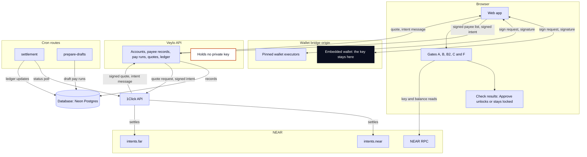
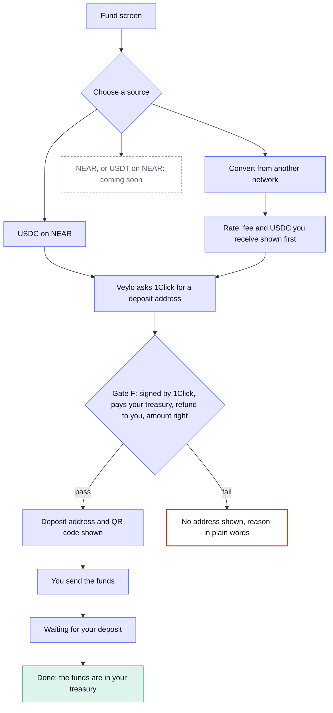
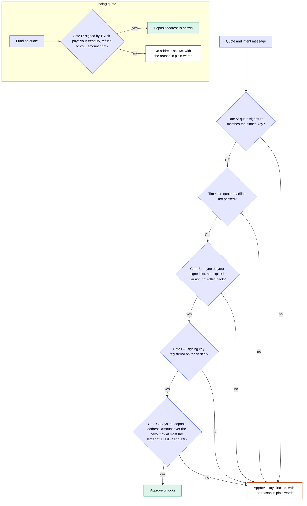
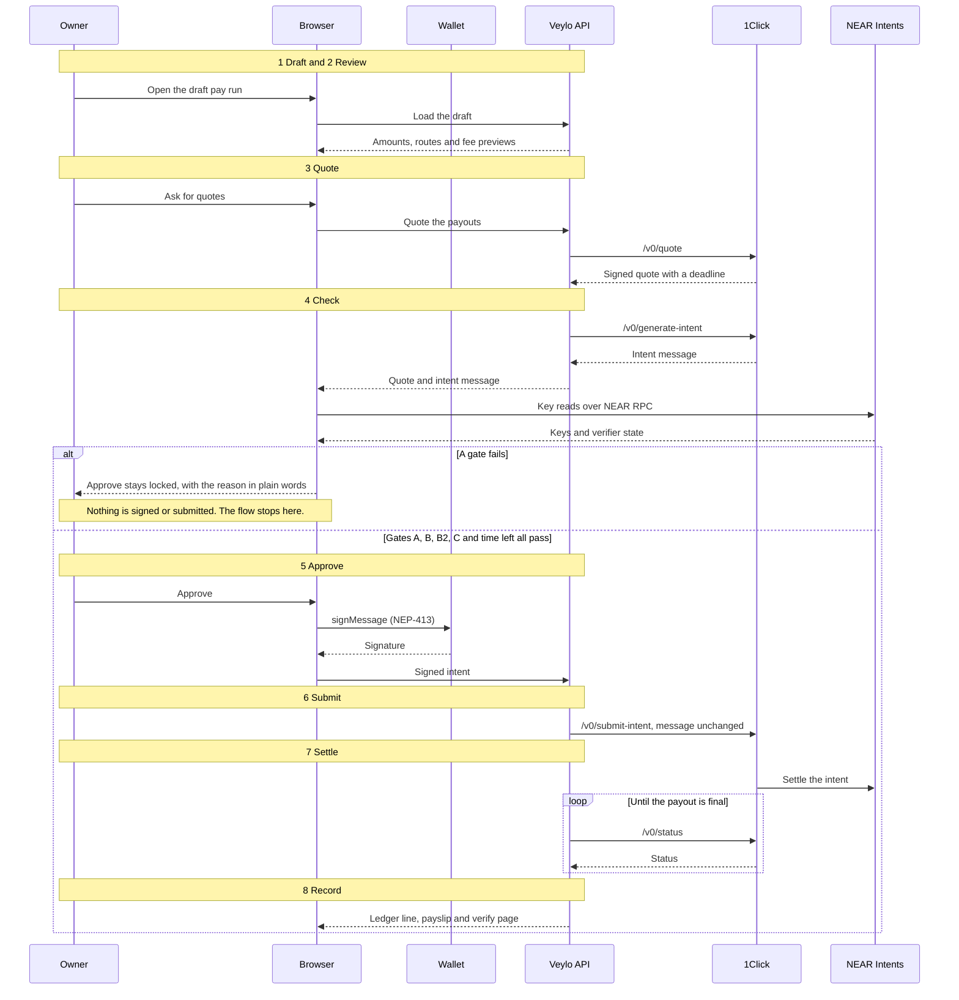
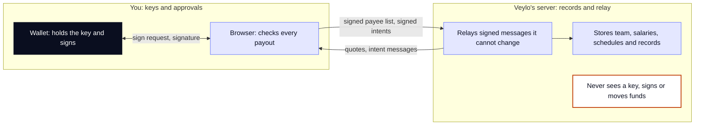

# Veylo

<p align="center"></p>

Veylo is private, borderless payroll on NEAR. It lets a company pay a global team in USDC from one treasury, without putting every salary on a public block explorer. Today, paying people in other countries is slow and expensive, and paying onchain fixes that but exposes who is paid, how much and when. Veylo keeps the speed and the low cost and removes the exposure.

Private means no public source we checked links a confidential payout to the company, provided the payout address has never received a public payment from it.

Add your team by hand or from a CSV, fund the treasury in USDC, and run a monthly pay run. Before you can approve anything, your browser checks that every quote is signed by NEAR Intents, that every recipient is on a payee list your own wallet signed, and that every amount is right. You approve each payout in your own wallet, either one of 7 NEAR wallets or a wallet Veylo creates for you at sign-up, and NEAR Intents delivers the USDC. Nobody needs a gas token, not you and not the person you pay.

**Live app:** [veylopay.vercel.app](https://veylopay.vercel.app) · **Repository:** [github.com/Shanks-btc/Veylo](https://github.com/Shanks-btc/Veylo) · **Demo video:** coming soon

## Try it in 2 minutes

**Live app:** https://veylopay.vercel.app is the real app: your own account, your own wallet, a real database ([docs/DEPLOY.md](docs/DEPLOY.md) section 14). To see the whole story with no wallet and no money, run the demo on your own computer: the six rows below, then the one-liner after them. They use made-up people and amounts, with a real recorded NEAR Intents quote.

| #   | Do                                                                                     | See                                                                                                                                                                                                                                        |
| --- | -------------------------------------------------------------------------------------- | ------------------------------------------------------------------------------------------------------------------------------------------------------------------------------------------------------------------------------------------ |
| 1   | Run `pnpm i && pnpm dev:web`, then open http://localhost:3000.                         | The landing page: "Pay your team anywhere. Keep payroll private."                                                                                                                                                                          |
| 2   | Click **Open app**, then **Use a wallet instead**, then **Use the demo wallet**.       | A real sign-in message is checked and signed by the demo wallet. You land on the treasury home.                                                                                                                                            |
| 3   | Open **Pay runs**, then the 2026-11 run, then **Check before signing**.                | Five checks turn to PASS (quote signature, payee list, key, amount, time left). **Approve payouts in wallet** unlocks.                                                                                                                     |
| 4   | Click **Redirect Kwame's payout to an attacker**.                                      | Four checks turn to FAIL (quote signature, payee list, amount, time left), in plain words ("The payee list your server sent isn't the one your treasury wallet signed"). Approve stays locked. **Undo the attack** brings the passes back. |
| 5   | Open **Privacy**.                                                                      | The same kind of payout seen two ways, read live from NEAR mainnet: the direct one can be followed from treasury to recipient; for the private one, no public transaction names the treasury.                                              |
| 6   | Open **Ledger**, then **Verify** on a payout, and download a payslip or statement PDF. | The verify page re-reads the payout's NEAR transactions and checks the amount and recipient. The PDF carries the same verify link.                                                                                                         |

With no keys and no money, in one line:

```
pnpm i && pnpm demo
```

It runs the whole story and prints 19 numbered checks in under a minute, from funding the treasury to a refused redirected payout, a payslip and CSV, the privacy proof, roles, CSV import, the contractor portal and the Veylo wallet. It exits non-zero if any check fails.

On the live app, funding works, but paying people needs the 1Click partner key, which isn't set yet: live payout quotes say "Live quotes are not connected yet" and nothing is sent. No email is sent yet either, and the screens say so.

## Contents

- [Try it in 2 minutes](#try-it-in-2-minutes)
- [The problem](#the-problem)
- [What Veylo does](#what-veylo-does)
- [How it works](#how-it-works)
- [Architecture](#architecture)
- [Core components](#core-components)
- [The pay run, step by step](#the-pay-run-step-by-step)
- [What Veylo's server does, and what it never does](#what-veylos-server-does-and-what-it-never-does)
- [What NEAR provides](#what-near-provides)
- [Wallets](#wallets)
- [Current status](#current-status)
- [Safety and tests](#safety-and-tests)
- [Quick start](#quick-start)
- [Environment variables](#environment-variables)
- [Repository layout](#repository-layout)
- [Roadmap](#roadmap)
- [Built at NEAR HACKATHON](#built-at-near-hackathon)
- [License](#license)

## The problem

Paying people in other countries is slow, expensive and exposed.

- **It is slow.** An international wire can take days to settle.
- **It is expensive.** Wires carry fees, and the exchange rate can hide a spread that isn't shown as a fee.
- **It is exposed.** Paying onchain fixes speed and cost, but a company wallet on a block explorer shows every salary: who is paid, how much, and when. Anyone can read it and follow it.

Veylo is built to keep the speed of paying onchain and remove the exposure. What that means exactly, and what has been checked, is under [What Veylo does](#what-veylo-does).

## What Veylo does

Veylo pays your contractors in USDC from one treasury on NEAR. Each person is paid privately or directly. Nobody, including you, needs a gas token to be paid. Every payout is checked in your browser before you approve it, and every payout gets a payslip and a line in your CSV export. Your treasury is held in USDC, so payroll doesn't change with crypto prices.

| Principle                                 | What it means                                                                                                                                                                                                                               |
| ----------------------------------------- | ------------------------------------------------------------------------------------------------------------------------------------------------------------------------------------------------------------------------------------------- |
| **Private by default**                    | Payouts are paid privately, from a confidential balance through NEAR Confidential Intents. A direct (public) payout is a separate, labelled choice for each contractor.                                                                     |
| **Only you can move money**               | Your treasury is your own wallet account. Veylo is non-custodial: its server never holds a key, can't sign for you, and can't change who gets paid. You approve each payout in your wallet.                                                 |
| **Your browser checks every payout**      | Before Approve unlocks, your browser checks that the quote is signed by NEAR Intents, that it pays someone on your signed payee list, that the signing key is yours, and that the amount is right. A payee's address change waits 24 hours. |
| **Gasless for everyone**                  | A payout is a message your wallet signs, and NEAR Intents settles it. No gas token for you, and none for the person you pay.                                                                                                                |
| **Any NEAR wallet or an embedded wallet** | Connect one of 7 NEAR wallets, or create a Veylo wallet at sign-up with a passkey or a password. No app to install.                                                                                                                         |
| **Nothing hidden**                        | If a check fails, approval is locked and the screen says which check and why. If data can't be loaded (a NEAR read, a currency rate), the screen says so, in words, and never shows a cached or invented answer.                            |

**What "private" means.** Private means no public source we checked links a confidential payout to the company, provided the payout address has never received a public payment from it. Private isn't anonymous: the contractor, Veylo and the settlement service can still see the details. The **Privacy** screen shows the difference live from NEAR mainnet, and the **Verify** page re-checks a direct payout from NEAR on every load.

**Private and direct payouts**

```mermaid
flowchart TB
  subgraph Direct["Direct payout"]
    direction LR
    dt["Treasury"] -->|"public"| dn["NEAR Intents, public balance: intents.near"]
    dn -->|"public"| dr["Recipient"]
    dr --> dres["Anyone can follow it from treasury to recipient"]
  end
  subgraph Private["Private payout"]
    direction LR
    pt["Treasury"] -->|"confidential"| pc["Confidential balance: intents.far"]
    pc -->|"confidential"| pr["Recipient"]
    pr --> pres["No public transaction names the treasury"]
  end
  classDef actor fill:#E4E7FF,stroke:#5B6CFF,color:#0A0E1F
  classDef amber fill:#FFF0D4,stroke:#F5B94A,color:#7A5200
  class dt,dn,dr,dres actor
  class pt,pc,pr,pres amber
```



_A direct payout can be followed from treasury to recipient. Private means no public source we checked links a confidential payout to the company, provided the payout address has never received a public payment from it._

**Money and currencies.**

- Salaries are set in US dollars, and the treasury is held in USDC.
- Funding is in USDC on NEAR, or converted from USDC or USDT on another network. A payout in NEAR is quoted at the time of payout and waits for its live test.
- Local currencies (NGN, EUR, GBP, KES, INR and others) are display-only estimates. The rates come from one public source (open.er-api.com), fetched by Veylo's server and cached for at most an hour. When it can't be reached the screen says "rate unavailable". An estimate is never used to work out, sign or send a payment.

**Compared with NEAR Business.** NEAR Business describes itself as a cross-chain multisig solution for managing confidential digital assets, with member roles and payment requests that members propose and approve ([docs](https://docs.business.near.com/), read 2026-11-12). The pages we read do not mention payroll, pay runs or payslips. Veylo is a payroll layer for a confidential treasury: contractors and pay runs, payslips and statements, a CSV for the accountant, and an owner-signed payee list. NEAR Business is a multisig where several members approve; Veylo has one owner wallet that signs. Several approvers are on the roadmap.

## How it works

**System architecture**



_The browser and the wallet hold the keys and run the checks; the API stores records and relays quotes and signed messages, and holds no private key._

A month in Veylo, from sign-up to payslips:

1. **Sign up.** Use an email and a password, or connect a NEAR wallet. The email account is for signing in, invitations and notices. It has no signing power.
2. **Get a wallet.** Create a Veylo wallet in seconds, or connect one you already have.
3. **Fund the treasury in USDC on NEAR.** The Fund screen shows an address and a QR code. USDC from Base, Arbitrum or Solana, and USDT from BNB Smart Chain, are converted by NEAR Intents: you see the rate, the fee and the USDC you receive first. USDT on NEAR and NEAR are marked "coming soon". [docs/FUNDING.md](docs/FUNDING.md) has the exact steps.
4. **Add your team.** One by one, or from a CSV ([docs/contractors-sample.csv](docs/contractors-sample.csv) shows the format). Enter a name and a NEAR account.
5. **Sign the payee list.** Your treasury wallet signs each approved address onto your payee list.
6. **Review the pay run.** A recurring schedule can prepare the draft three days before payday. Nothing is quoted or signed until you open it. You see each amount, route and fee.
7. **Approve in your wallet.** Your browser runs its checks on every payout. A new payee, a new address or an unusual amount needs you to tick "I've checked this". If every check passes, you approve each payout in your wallet, one approval per payout.
8. **Payouts settle,** usually within a minute or two.
9. **Payslips and verification.** Every settled payout has a payslip (PDF), appears in the ledger and the CSV, and has a verify page.

**A month in Veylo**

```mermaid
flowchart LR
  m1["Sign up"] --> m2["Get a wallet"] --> m3["Fund in USDC on NEAR"] --> m4["Add team"] --> m5["Sign payee list"] --> m6["Review pay run"] --> m7["Approve in wallet"] --> m8["Settle"] --> m9["Payslips and verify"]
  classDef actor fill:#E4E7FF,stroke:#5B6CFF,color:#0A0E1F
  classDef keys fill:#0A0E1F,stroke:#0A0E1F,color:#FFFFFF
  classDef ok fill:#DDF4EA,stroke:#1E9E6A,color:#0A0E1F
  class m1,m2,m3,m4,m6,m8 actor
  class m5,m7 keys
  class m9 ok
```



_The dark steps need your wallet's signature: the payee list and each payout._

**Funding the treasury**



_USDC on NEAR needs no conversion, USDC or USDT from another network is converted by NEAR Intents, and NEAR or USDT on NEAR are coming soon._

**Roles.** The owner does everything and signs with the treasury wallet. A preparer creates and edits drafts and contractors, and can't approve addresses or sign. An accountant reads the ledger, payslips, statements, CSV and audit log, and sees a contractor's name and route, nothing else personal.

## Architecture

| Layer                        | Responsibility                                                                                                                                                                                          | Location                                                                                          |
| ---------------------------- | ------------------------------------------------------------------------------------------------------------------------------------------------------------------------------------------------------- | ------------------------------------------------------------------------------------------------- |
| Web app                      | A static Next.js site with a strict content-security policy: the landing page, the owner app, the contractor portal, and the public verify and privacy pages. It runs every browser check.              | `apps/web/src`                                                                                    |
| Wallet bridge origin         | A separate web address that loads wallet code pinned by SHA-256 and holds the embedded wallet's key. The app and the bridge talk by messages, and never share storage.                                  | `apps/web/bridge`, `apps/web/src/wallet`                                                          |
| Embedded wallet              | Key creation, the encrypted vault (passkey or password), the recovery phrase, and signing.                                                                                                              | `apps/web/bridge/embedded`                                                                        |
| Browser gates                | The checks that run before you approve: A, B, B2, C for payouts and F for funding.                                                                                                                      | `apps/web/src/gates`                                                                              |
| API                          | Fastify: accounts, organisations, roles, contractors, payee records, pay runs, quotes, ledger and reports.                                                                                              | `apps/api/src`                                                                                    |
| Cron routes                  | On Vercel, two protected routes replace the long-running worker: `settlement` (poll status, reconcile) and `prepare-drafts` (scheduled drafts). A bearer secret guards them.                            | `apps/api/src/cron-routes.ts`, `hosted.ts`, `settlement.ts`, `scheduler.ts`                       |
| Database                     | PostgreSQL (Neon on Vercel) with Drizzle migrations. Every query is scoped to one organisation.                                                                                                         | `packages/db`                                                                                     |
| NEAR Intents / 1Click client | A thin in-house client for quotes, intent messages, submission and status, with the quote-signature check.                                                                                              | `packages/intents`                                                                                |
| Domain rules                 | Pure money rules with no network or database: pay runs, fees, review flags, schedules, CSV.                                                                                                             | `packages/core`                                                                                   |
| Chains and shared code       | Address validation, NEAR RPC reads and explorer links (`packages/chains`); request and response schemas (`packages/contract`); environment schema (`packages/config`); encryption (`packages/secrets`). | `packages/*`                                                                                      |
| Verify and proof pages       | Re-read a payout's NEAR transactions in the browser, and show the privacy difference live.                                                                                                              | `apps/web/src/proof`, `apps/web/src/screens/verify.tsx`, `apps/web/src/screens/privacy-proof.tsx` |

On Vercel the web app, the wallet bridge and the API are three projects: `veylopay`, `veylo-wallet` and `veylo-srv`. The web app forwards `/api/*` to the API. The deploy runbook is [docs/DEPLOY.md](docs/DEPLOY.md); the design is in [ARCHITECTURE.md](ARCHITECTURE.md).

## Core components

| Component                  | What it does                                                                                                                                                                       | Where                                                                                               |
| -------------------------- | ---------------------------------------------------------------------------------------------------------------------------------------------------------------------------------- | --------------------------------------------------------------------------------------------------- |
| Gate A, the quote verifier | Checks 1Click's ed25519 signature on the quote against the key pinned in the code.                                                                                                 | `apps/web/src/gates/signed-quote.ts`, `packages/intents/src/quote-signature.ts`                     |
| Gate B, the payee list     | The quote's recipient, asset and type must match an unexpired payee on the list your treasury wallet signed. The wallet's public key is read from NEAR, never from Veylo's server. | `apps/web/src/gates/registry.ts`, `rpc.ts`                                                          |
| Gate B2, the signing key   | Confirms through NEAR RPC that the wallet's signing key is registered for your treasury on the verifier the message names (`intents.near` or `intents.far`).                       | `apps/web/src/gates/index.ts`                                                                       |
| Gate C, the amount         | The message must pay the quote's deposit address, and the signed amount may exceed the payout by at most the larger of 1 USDC and 1% of it.                                        | `apps/web/src/gates/index.ts`                                                                       |
| Gate F, funding            | Before a deposit address is shown, checks 1Click's signature on the funding quote, that the funds go to your own treasury, that a refund returns to you, and the amount.           | `apps/web/src/gates/funding.ts`                                                                     |
| Payee registry             | Your treasury wallet signs each payee and a versioned head of the whole list. The browser remembers the highest version it has seen and refuses a lower one. Approvals expire.     | `packages/intents/src/payee.ts`, `apps/web/src/gates/high-water.ts`, `apps/api/src/payee-routes.ts` |
| Embedded wallet            | A wallet created in the browser. Its key is kept on the bridge origin, protected by a passkey or a password, and a recovery phrase must be confirmed before use.                   | `apps/web/bridge/embedded`                                                                          |
| Scheduler                  | Prepares a draft pay run before payday from a recurring schedule. It has a database and a clock and nothing else: it can't quote, sign or send.                                    | `apps/api/src/scheduler.ts`, `packages/core/src/schedule.ts`                                        |
| CSV importer               | Adds many contractors from one file, and shows each row's problem before anything is saved.                                                                                        | `apps/api/src/contractor-import.ts`, `packages/core/src/csv.ts`                                     |
| Contractor portal          | A contractor sees their own payslips and private balance and sets their payout address. Cash-out from the portal waits for its live test.                                          | `apps/web/src/screens/portal.tsx`, `apps/api/src/portal-routes.ts`                                  |
| Verify page                | Re-reads a direct payout's NEAR transactions and checks the amount and the recipient. For a private payout it shows the recorded status.                                           | `apps/web/src/screens/verify.tsx`, `apps/web/src/proof/verify.ts`                                   |

**How the gates decide**



_A quote and its intent message must pass every check in order, and any failure keeps Approve locked; Gate F does the same for a funding quote._

## The pay run, step by step

| Step | Name    | What happens                                                                                                                                                                           | Who signs / which NEAR call                                                                                             |
| ---- | ------- | -------------------------------------------------------------------------------------------------------------------------------------------------------------------------------------- | ----------------------------------------------------------------------------------------------------------------------- |
| 1    | Draft   | You create the pay run, or the scheduler prepares it before payday. Amounts come from each contractor's terms.                                                                         | Nobody. Nothing is quoted.                                                                                              |
| 2    | Review  | You see each amount, route and fee, and flags for a new payee, a new address or an unusual amount.                                                                                     | Nobody. Fee previews come from dry quotes that cannot be paid.                                                          |
| 3    | Quote   | Veylo's server asks 1Click for a live quote for each payout (`/v0/quote`). Each quote has a deadline, 15 minutes by default.                                                           | The server calls 1Click. No signature.                                                                                  |
| 4    | Check   | The server asks 1Click for the intent message for each quote (`/v0/generate-intent`). Your browser runs gates A, B, B2 and C on the quote and the message. Any failure locks approval. | Nobody signs. The browser reads NEAR RPC (`view_access_key_list`, `has_public_key`).                                    |
| 5    | Approve | You approve in your wallet, one prompt per payout. The wallet signs the message unchanged.                                                                                             | Your treasury wallet, with NEP-413 `signMessage`. It signs a message, not a transaction.                                |
| 6    | Submit  | Your browser returns the signatures and the server submits each signed intent to 1Click (`/v0/submit-intent`).                                                                         | No new signature. The server holds a signed message it cannot change.                                                   |
| 7    | Settle  | NEAR Intents settles each payout, in parallel. Veylo polls `/v0/status` until each one is final.                                                                                       | Nobody. NEAR Intents' verifier (`intents.near`, or `intents.far` for a confidential payout) executes the signed intent. |
| 8    | Record  | After a short delay the payout is reconciled. It gets a ledger line, a CSV row, a payslip and a verify page.                                                                           | Nobody.                                                                                                                 |

**The pay run as a sequence**



_A failed gate stops the flow before anything is signed, and a payout is submitted after every gate passes and you approve it in your wallet._

A payout moves through these statuses:

| Status     | What it means                                                                      | What to do                                                                                                     |
| ---------- | ---------------------------------------------------------------------------------- | -------------------------------------------------------------------------------------------------------------- |
| QUOTED     | A price is ready and waiting for your approval. Quotes expire after a few minutes. | Review and approve it before the countdown ends.                                                               |
| SIGNED     | You approved it in your wallet.                                                    | Nothing. It's sent next.                                                                                       |
| SUBMITTED  | It's been sent to NEAR Intents for settlement.                                     | Nothing. Wait.                                                                                                 |
| PROCESSING | NEAR Intents is settling it.                                                       | Nothing. Wait a minute or two.                                                                                 |
| SUCCESS    | The contractor has been paid.                                                      | Nothing. The payslip is ready.                                                                                 |
| REFUNDED   | It couldn't be delivered, and the money went back to your treasury.                | Check the contractor's address, then pay again in a new pay run.                                               |
| FAILED     | It didn't go through. Anything not delivered returns to your treasury.             | Read the reason on the status screen, check the ledger's refunded amount, fix the cause, and retry the payout. |
| EXPIRED    | The quote ran out before it was approved. No money moved.                          | Get a new quote and approve it in time.                                                                        |

<details>
<summary>Reading the CSV export</summary>

Export it from **Ledger → Export CSV** for any date range. It lists live payouts only, never test or simulated ones. Dates are ISO 8601 in UTC, and amounts are exact to 6 decimal places.

| Column                     | Meaning                                                               |
| -------------------------- | --------------------------------------------------------------------- |
| `date`                     | When the payout reached its final status (ISO 8601, UTC).             |
| `pay run period`           | The pay run it belongs to, such as `2026-11`.                         |
| `contractor name`          | Who was paid.                                                         |
| `amount`                   | What the contractor received.                                         |
| `currency`                 | Always `USDC`.                                                        |
| `route`                    | How they were paid, such as `USDC confidential balance on NEAR`.      |
| `chain`                    | Where it was delivered, such as `NEAR`.                               |
| `recipient`                | The contractor's payout address.                                      |
| `delivery fee`             | The network's delivery fee.                                           |
| `total fee`                | Everything paid on top of `amount`.                                   |
| `status`                   | The final status (see the table above).                               |
| `reconciled`               | `yes` once the payout was checked against the treasury's balance.     |
| `refunded amount`          | Any amount returned to the treasury.                                  |
| `deposit address`          | The settlement address for this payout.                               |
| `intent hash`              | The ID of the signed intent.                                          |
| `NEAR tx hash`             | The NEAR transaction(s), space-separated.                             |
| `destination tx hash`      | The delivery transaction, if public.                                  |
| `destination explorer URL` | A link to the delivery transaction, if public.                        |
| `transaction link`         | A link to look the payout up, or `confidential` for a private payout. |
| `payslip ID`               | The payslip's ID, as shown in the app.                                |

</details>

## What Veylo's server does, and what it never does

| Veylo's server does                                                                             | Veylo's server never does                                                                                            |
| ----------------------------------------------------------------------------------------------- | -------------------------------------------------------------------------------------------------------------------- |
| Stores your team, their salaries, schedules and records (ledger, payslips, audit log).          | See a private key: not your treasury wallet's, not the Veylo wallet's.                                               |
| Stores the payee list your wallet signed, and the signatures with it.                           | Sign anything for your treasury.                                                                                     |
| Fetches quotes and intent messages from 1Click, and submits the intents you signed.             | Move funds. Only a payout you approved in your wallet can leave the treasury.                                        |
| Polls each payout's status and reconciles it with the treasury's balance.                       | Change who gets paid or how much: your browser refuses a list or a quote your wallet didn't sign.                    |
| Keeps the 1Click partner key and session tokens, encrypted, on the server tier that needs them. | Log signed payloads. Request logs carry no headers, bodies or query strings, and signatures and tokens are redacted. |
| Reads currency rates for display-only estimates.                                                | Use a currency estimate to work out, sign or send a payment.                                                         |
| Writes each email to an outbox table (nothing sends it yet).                                    | Let an email account unlock a wallet. A password reset never restores a wallet.                                      |

**The trust boundary**



_Keys and approvals stay with you; the server stores records and relays messages it cannot change._

## What NEAR provides

| NEAR piece                                   | What Veylo uses it for                                                                                                                                                               |
| -------------------------------------------- | ------------------------------------------------------------------------------------------------------------------------------------------------------------------------------------ |
| NEAR Intents (`intents.near`, `intents.far`) | The treasury. It holds its USDC as a NEAR Intents balance and pays from it. `intents.near` holds the public balance, and `intents.far` is the verifier for the confidential balance. |
| 1Click API                                   | NEAR Intents' swap and deposit API. Veylo uses it for quotes, deposit addresses, funding and status. Every quote's signature is checked in the browser against the pinned key.       |
| Confidential Intents                         | The confidential balance that private payouts are paid from.                                                                                                                         |
| NEP-413 signing                              | How a wallet signs the sign-in message, the payee list and each payout. The wallet layer signs messages only, never transactions.                                                    |
| `@hot-labs/near-connect` (HOT)               | How wallets connect. HOT's open wallet connector provides the wallet list; Veylo enables 7 wallets from it ([Wallets](#wallets)).                                                    |
| Implicit accounts                            | The Veylo wallet's account is the 64-character hex of its public key, which any NEAR wallet can use. It needs no registration to sign an intent.                                     |
| NEP-141 USDC                                 | The money: Circle's native USDC on NEAR. NEAR RPC is read directly from the browser to check keys and balances.                                                                      |

**Mandatory integrations: none.** No integration is mandatory for this hackathon (Q-011). Veylo uses these because they are what it is built on.

**Why there's no gas and no relayer.** A relayer pays the gas for a transaction a user signed. NEAR's meta-transactions tutorial describes a relayer that pays gas from its own funded account for a signed delegate action, and that can choose which calls it sponsors ([meta transactions](https://docs.near.org/web3-apps/tutorials/meta-transactions)). Veylo doesn't run a contract of its own, and a payout isn't a call to one. It is an off-chain signed intent from the treasury's NEAR Intents balance: the wallet signs a message, and NEAR Intents settles it. Nobody pays gas, so there is nothing for a relayer to sponsor. The flow is documented here: [signed intent execution](https://docs.near-intents.org/integration/distribution-channels/1click-api/quickstart/signed-intent-execution). Funding is different: sending USDC from your own NEAR wallet is an ordinary transaction, and that wallet pays NEAR for it.

## Wallets

Veylo enables 7 NEAR wallets: **HOT Wallet, Meteor Wallet, Intear Wallet, MyNearWallet, OKX Wallet, NEAR Mobile and Nightly Wallet.** A wallet is enabled only if it signs a message with NEP-413, needs no hardware or relay permission, talks only to hosts that were reviewed, and ships code that is pinned by SHA-256. Seven others were left out, each with its reason. The full list, the hashes and the hosts are in [docs/WALLETS.md](docs/WALLETS.md).

Whichever wallet signs, the app verifies the signature over the exact bytes, the key and the account itself, every time, and the browser gates are the same.

**The Veylo wallet.** At sign-up you can create a wallet with no app to install. Its key is generated in your browser, on the separate wallet web address, and kept encrypted there, protected by a passkey (WebAuthn) or a separate wallet password (Argon2id). A recovery phrase is shown once and must be confirmed before the wallet can be used. Veylo's server never sees the key. If you lose this device and your recovery phrase, Veylo can't recover it.

**Tested with a real wallet:** Meteor only. The other six were read and fixture-tested; a live test of each needs the founder.

## Current status

| Surface                                                           | Status         | Detail                                                                                                                                                                                                                                                                                |
| ----------------------------------------------------------------- | -------------- | ------------------------------------------------------------------------------------------------------------------------------------------------------------------------------------------------------------------------------------------------------------------------------------- |
| Web app, wallet bridge and API on Vercel                          | Live           | PostgreSQL on Neon, migrations applied, the deployed files checked byte for byte against the reviewed build.                                                                                                                                                                          |
| Accounts, team, contractors, CSV import, schedules, roles, ledger | Live           | Stored in the database. Every query is scoped to one organisation.                                                                                                                                                                                                                    |
| Payslips, statements, CSV export, audit log, verify page          | Live           | PDFs carry a verify link. The verify page reads NEAR on every load.                                                                                                                                                                                                                   |
| Browser gates A, B, B2, C and F                                   | Live           | Tested against recorded real 1Click quotes, including tampered ones. The demo's tamper test shows them failing on purpose.                                                                                                                                                            |
| Funding with USDC on NEAR (one-time deposit address)              | Live           | Tested once on mainnet through the live app: 1.000000 USDC from a Meteor wallet to a one-time deposit address, final status Done ([docs/EVIDENCE.md](docs/EVIDENCE.md) Section 1, recorded by hand from the founder's report). The quote and its status work without the partner key. |
| Funding with USDC from Base, Arbitrum or Solana, USDT from BNB    | Live           | Quoted by NEAR Intents. USDT from BNB Smart Chain was tested on mainnet by a test script (EVIDENCE Section 2, rows 1 to 5). The others are fixture-tested.                                                                                                                            |
| Payouts, private and direct (USDC)                                | Fixture-tested | Live quotes need the 1Click partner key, which isn't set on the live app yet. Mechanisms were proven on mainnet by test scripts. Direct USDC to a NEAR account waits for spike S-N.                                                                                                   |
| Seven NEAR wallets                                                | Fixture-tested | Only Meteor was tried with a real wallet.                                                                                                                                                                                                                                             |
| The Veylo wallet                                                  | Fixture-tested | Run in browser tests across two real origins. Its mainnet test (spike S-EW) has not run.                                                                                                                                                                                              |
| Contractor portal: payslips, private balance, payout address      | Live           | The contractor's own view only.                                                                                                                                                                                                                                                       |
| Local-currency estimates                                          | Live           | Display only. Shows "rate unavailable" when the source can't be reached.                                                                                                                                                                                                              |
| Funding with NEAR, or USDT on NEAR                                | Coming soon    | Waiting for live tests (spikes S-F2 and S-FT).                                                                                                                                                                                                                                        |
| Payouts in NEAR                                                   | Coming soon    | Quoted at payout time. Waiting for its live test (spike S-NR). Direct only.                                                                                                                                                                                                           |
| Cash-out from a contractor's private balance                      | Coming soon    | Proven by a test script (EVIDENCE Section 2, rows 24 to 26). The portal's version waits for spike S-P.                                                                                                                                                                                |
| Email delivery                                                    | Coming soon    | Messages are written to an outbox and nothing sends them yet. The screens say so.                                                                                                                                                                                                     |
| Mainnet evidence                                                  | See the file   | [docs/EVIDENCE.md](docs/EVIDENCE.md), exactly as it stands: product payouts "None yet"; one funding made through the live app (Section 1); and 31 transactions from test scripts, not the product (Section 2).                                                                        |

**Mainnet evidence.** [docs/EVIDENCE.md](docs/EVIDENCE.md) lists every transaction, and `pnpm verify` re-checks each row against public RPC with no keys.

- **Made through the product (Section 1).** Payouts made by the product itself: Section 1 says "None yet." One funding is listed: on 2026-11-16 the founder sent 1.000000 USDC on NEAR from their own Meteor wallet to a one-time deposit address shown by the live app's "Send USDC on NEAR" flow, and the app's final status was Done. That row was recorded by hand from the founder's report after the transaction was read from public RPC. It is a funding, not a payout.
- **Made by test scripts (Section 2).** The mechanisms Veylo relies on were tested on NEAR mainnet with tiny amounts (0.03 to 2 USDC) by test scripts, not by the product: funding a treasury through a 1Click deposit address, payouts from that balance (public and confidential) delivered on other chains, a shield from the public to the confidential balance, and a cash-out from the confidential balance. One private receipt between two confidential balances has no public transaction by design, so it can't be re-checked.

NEAR Intents has no testnet (Q-007), so these tests use mainnet. Every remaining test is prepared in [VERIFICATION.md](VERIFICATION.md) and refuses to run without the founder's approval.

## Safety and tests

- **Browser gates fail closed.** Any failed check locks Approve. Tamper checks change one field of a valid quote, payee list or payout message and expect a refusal; the demo shows this live.
- **One organisation can't see another.** Every query is scoped to the signed-in organisation, and a dedicated suite tries to cross the line.
- **Nothing is claimed beyond the evidence.** Tests fail if this README or the app's copy claims to be the best, the sole or a one-off, or promises anything Veylo doesn't offer.
- **Every page is checked at many sizes.** A crawler follows every link and button at 17 screen sizes from 320 px to 1920 px in Chrome, with axe accessibility checks. The landing page is checked at 34 sizes in Chromium and WebKit.

| Check                                  | Latest result                             |
| -------------------------------------- | ----------------------------------------- |
| `pnpm test` (all tests)                | 2833 tests passed, 7 skipped, in 94 files |
| Tenant isolation suite                 | 238 of 238 passed                         |
| Address validation suite               | 73 of 73 passed                           |
| Mainnet evidence re-check (public RPC) | 32 of 32 passed                           |
| `pnpm demo`                            | 19 of 19 checks passed                    |
| Deployed app, checked over the network | 47 of 47 checks passed                    |

## Quick start

**Requirements:** Node 24 and pnpm 11 (set in `package.json`). A Postgres database is needed only for `pnpm dev:wallet` and the API.

```
pnpm install --frozen-lockfile
```

| Command                                | What it does                                                                                                                                                                                                                                                                              |
| -------------------------------------- | ----------------------------------------------------------------------------------------------------------------------------------------------------------------------------------------------------------------------------------------------------------------------------------------- |
| `pnpm dev:web`                         | The app with demo data at http://localhost:3000. Nothing is saved, signed or sent.                                                                                                                                                                                                        |
| `pnpm dev:wallet`                      | The app with a real wallet and a local database. The steps are in [docs/DEPLOY.md](docs/DEPLOY.md) section 13.                                                                                                                                                                            |
| `pnpm demo`                            | The whole story with no keys, 19 numbered checks.                                                                                                                                                                                                                                         |
| `pnpm build`                           | Builds the API. `pnpm --filter @veylo/web build:demo` builds the web app with demo data and needs no settings. A real web build stops unless the public `NEXT_PUBLIC_*` settings in [docs/DEPLOY.md](docs/DEPLOY.md) section 14 are set; `pnpm verify` builds it with placeholder values. |
| `pnpm verify`                          | Typecheck, every test, and the mainnet evidence re-check.                                                                                                                                                                                                                                 |
| `pnpm --filter @veylo/web check:pages` | The page crawler, 17 screen sizes and axe. Needs Chrome. `check:embedded`, `check:browser` and `check:lighthouse` are siblings.                                                                                                                                                           |
| `pnpm wallets:refresh`                 | Prints what changed in the wallet manifest. Writes nothing without the founder's approval.                                                                                                                                                                                                |

## Environment variables

Names only. Never put a value in this repository, and never print a secret. Each process loads only the variables it needs and fails at start, naming the one that is missing.

| Name                              | Required     | Service         | Description                                                                                               |
| --------------------------------- | ------------ | --------------- | --------------------------------------------------------------------------------------------------------- |
| `DATABASE_URL`                    | Yes          | API, workers    | PostgreSQL connection URL (`postgres://` or `postgresql://`). A secret.                                   |
| `SESSION_ENCRYPTION_KEY`          | Yes          | API, settlement | 32 random bytes, base64. Encrypts 1Click session tokens. A secret.                                        |
| `AUTH_RECIPIENT`                  | Yes          | API             | The app identifier wallets sign for.                                                                      |
| `WEB_ORIGIN`                      | Yes          | API             | The web app's origin, with no path. Allowed by CORS.                                                      |
| `NODE_ENV`                        | Yes          | All             | `development`, `test` or `production`.                                                                    |
| `LOG_LEVEL`                       | Yes          | All             | `fatal`, `error`, `warn`, `info`, `debug` or `trace`.                                                     |
| `ONECLICK_PARTNER_KEY`            | No           | API, settlement | The 1Click partner key. Without it, live payout quotes say "Live quotes are not connected yet". A secret. |
| `CRON_SECRET`                     | No           | API on Vercel   | At least 32 characters. The bearer token the cron routes check. Without it they are not served. A secret. |
| `NEARAI_API_KEY`                  | Agent worker | `worker:agents` | NEAR AI Cloud API key. A secret.                                                                          |
| `AGENT_KEY_MASTER_KEY`            | Agent worker | `worker:agents` | 32 random bytes, base64. Never given to the API. A secret.                                                |
| `NEAR_RPC_URL`                    | No           | API             | NEAR RPC for the sign-in key check. Default `https://rpc.fastnear.com`.                                   |
| `SESSION_TTL_HOURS`               | No (24)      | API             | Session lifetime, 1 to 720.                                                                               |
| `PORT`                            | No (3000)    | API             | Port the API listens on.                                                                                  |
| `TRUST_PROXY_HOPS`                | No (0)       | API             | Proxy hops trusted for the client IP used by rate limits. 1 on Vercel (measured).                         |
| `LOG_CLIENT_IP`                   | No (false)   | API             | `true` only during the proxy check, then off.                                                             |
| `TREASURY_LIMIT_ORG_PER_HOUR`     | No (60)      | API             | Live-quote and signing-request limit per organisation, per route, per hour.                               |
| `TREASURY_LIMIT_USER_PER_HOUR`    | No (30)      | API             | The same limit per user.                                                                                  |
| `PAYOUT_QUOTE_DEADLINE_MINUTES`   | No (15)      | API             | How long a payout quote stays valid, 1 to 60.                                                             |
| `REVIEW_AMOUNT_DEVIATION_PERCENT` | No (25)      | API             | The change in an amount that flags a pay-run item.                                                        |
| `ONECLICK_QUOTE_PUBLIC_KEY`       | No           | API             | 1Click's quote-signing key. Default: the key pinned in the code.                                          |
| `EVIDENCE_*_RPC_URL`              | No           | `pnpm verify`   | Public RPC endpoints (NEAR, Base, Arbitrum, BSC, Solana) for the evidence re-check. No keys.              |

[.env.example](.env.example) lists them all, empty. [docs/DEPLOY.md](docs/DEPLOY.md) section 3 says which service loads which.

## Repository layout

```
apps/
  api/            Fastify API, settlement worker, Vercel entry (src/, build.mjs, build-vercel.mjs)
  web/            Next.js static export: landing page, owner app, contractor portal
    bridge/       The wallet bridge origin and the embedded wallet
    scripts/      Build, serve and browser-check scripts
    src/          app, screens, landing, gates, wallet, signing, proof, portal, reports
packages/
  core/           Pure money and pay-run rules, no network or database
  intents/        NEAR Intents and 1Click client, NEP-413, quote and payee checks
  chains/         Address validation, NEAR RPC, explorers
  contract/       Request and response schemas shared by the API and the web app
  db/             Drizzle schema, migrations, repositories
  config/         Environment schema
  secrets/        Envelope encryption
tools/verify/     pnpm verify, the demo, the evidence re-check, the live check
docs/             DEPLOY, EVIDENCE, FUNDING, WALLETS, PUBLIC-READINESS, ECOSYSTEM
design/           Images, screenshots and the reference landing page
verification/     Mainnet test scripts, kept apart and never imported by the product
```

Also at the top level: [ARCHITECTURE.md](ARCHITECTURE.md), [DECISIONS.md](DECISIONS.md), [VERIFICATION.md](VERIFICATION.md), [SECURITY.md](SECURITY.md), [PRIVACY.md](PRIVACY.md) and [docs/PUBLIC-READINESS.md](docs/PUBLIC-READINESS.md).

                                                                                                                                                                             |

## Roadmap

After the hackathon:

- **Several approvers for a pay run.** The design is in [docs/ECOSYSTEM.md](docs/ECOSYSTEM.md).
- **Other chains.** The code for Base, Arbitrum and Solana payouts exists and is switched off.
- **Bank cash-out in local currency through licensed partners (after the hackathon).** Not built.
- **The remaining mainnet tests** in [VERIFICATION.md](VERIFICATION.md), so the "coming soon" items can go live.

## Built at NEAR HACKATHON

Built at NEAR HACKATHON, for the Real-World Money (`realworld`) and Privacy & Private AI (`privacy`) tracks. All code in this repository was written during the hackathon window (from the 2026-10-19 announcement), with no pre-existing project (Q-001 and Q-005).

**AI disclosure.** Claude Code (Anthropic) wrote and tested the code with the founder.

**Libraries and services.**

| Area               | What                                                                                                                                                                                                                                                                   |
| ------------------ | ---------------------------------------------------------------------------------------------------------------------------------------------------------------------------------------------------------------------------------------------------------------------- |
| Language and tools | TypeScript 5.9.3, Node 24, pnpm 11, Vitest 4.1.12, Prettier 3.9.10, esbuild 0.28.2, tsx 4.23.15, Zod 4.6.7                                                                                                                                                             |
| API                | Fastify 5.12.8 (cookie, cors, helmet and rate-limit plugins), Drizzle ORM 0.45.4, PostgreSQL (`pg` 8.23.1), pg-boss 12.38.1, pino 10.4.0                                                                                                                               |
| Web                | Next.js 16.4.3 (static export), React 19.3.1, three.js 0.186.1, Phosphor Icons 2.1.10, Fontsource (Inter Tight, IBM Plex Mono, Instrument Serif) 5.3.0, sharp 0.35.5                                                                                                   |
| NEAR and crypto    | `@hot-labs/near-connect` 0.12.0, near-api-js 7.4.0 and `@defuse-protocol/intents-sdk` 0.95.0 (in the `verification/` test scripts only), `@noble/curves`, `@noble/hashes`, `@noble/ciphers` 2.4.0, `@scure/base` 2.4.0, `@scure/bip39` 2.4.0, `qrcode-generator` 2.0.4 |
| Checks             | Playwright 1.64.1 (Chromium and WebKit), axe-core 4.14.0, Lighthouse 13.5.0                                                                                                                                                                                            |
| Services           | NEAR Intents (1Click API), NEAR RPC (fastnear), Vercel, Neon                                                                                                                                                                                                           |

## License

MIT. See [LICENSE](LICENSE).
